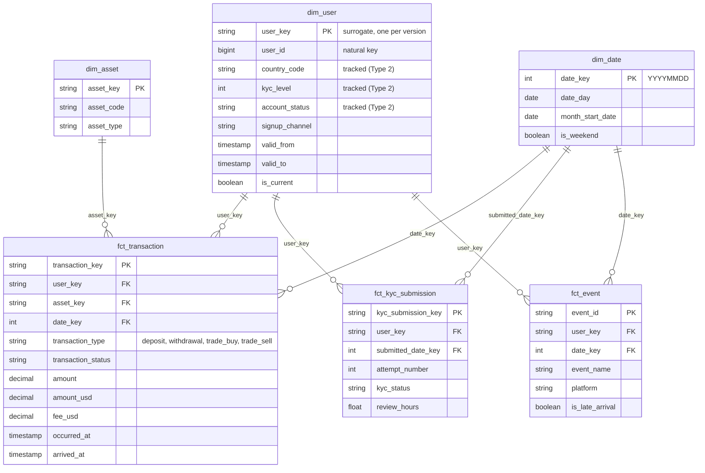
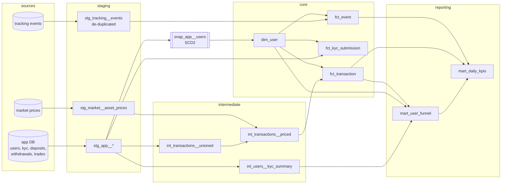

# exchange-analytics-dbt

A small, runnable data warehouse for a fictional crypto exchange, built with dbt on DuckDB.
It covers the user journey end to end: registration, KYC, deposits, trades, withdrawals, and
product analytics events in the shape of a GA4 / Mixpanel export.

All data is synthetic and generated by a script in this repo. It runs locally in under a
minute with no cloud account and no Docker.

## What it demonstrates

| Topic | Where |
|---|---|
| Kimball star schema with stated grains | `models/marts/core` |
| Slowly changing dimension, Type 2 | `snapshots/snap_app__users.yml`, `dim_user` |
| Point-in-time joins from facts to the dimension | `fct_transaction`, `fct_kyc_submission`, `fct_event` |
| Incremental loading that is safe to rerun | `fct_transaction`, `fct_event`, `macros/incremental_lookback_filter.sql` |
| Duplicates, late-arriving rows, inconsistent codes | handled in `models/staging` |
| Tests, including reconciliation and a unit test | `tests/`, `_*.yml` files |
| CI that runs a two-day scenario | `.github/workflows/ci.yml` |

## Star schema



### Grain

| Table | One row per |
|---|---|
| `fct_transaction` | money movement: one deposit, one withdrawal, or one trade execution |
| `fct_kyc_submission` | KYC verification attempt |
| `fct_event` | tracking event, after de-duplication |
| `dim_user` | user per version (Type 2) |
| `mart_user_funnel` | user |
| `mart_daily_kpis` | calendar day, including days with no activity |

## Lineage



## Design decisions

### Slowly changing dimension

The backend overwrites a user's country, KYC level and account status in place. A dbt
snapshot (`timestamp` strategy on `updated_at`) keeps each version, and `dim_user` exposes
them with `valid_from`, `valid_to` and `is_current`.

- Facts join on `user_id` plus the event time falling inside `[valid_from, valid_to)`. A trade
  made at KYC level 0 stays attributed to level 0 after the user upgrades.
- Open versions end at `9999-12-31` instead of NULL, so the range join has no special case.
- A user's first version is backdated to their registration time. Without that, any fact older
  than the first snapshot run would match no version.
- An `unknown` member (`user_id = -1`) gives anonymous tracking events a valid foreign key.
- Reports that want "who the user is today", such as the funnel, filter on `is_current`.

### Incremental loading

`fct_transaction` and `fct_event` use `delete+insert` on a unique key.

- **Filter on arrival time, not event time.** Rows are selected by `updated_at` / `received_at`.
  A trade executed last week but written today is picked up however late it is. Filtering on
  the event time would skip it.
- **Watermark from the target table, minus a lookback** (`incremental_lookback_days`, default 3).
  After an outage the next run continues from where the table stopped. It does not depend on
  the current date.
- **Updates replace, they do not append.** A deposit that goes from `pending` to `completed`
  is re-read and replaces its earlier row.
- **Reruns are safe.** Running the same build twice gives the same table. CI does exactly this.
- **Backfill** with a wider window (`dbt build --vars '{incremental_lookback_days: 30}'`) or
  rebuild with `--full-refresh`.
- **A reconciliation test** compares the incremental fact to the sources by row count and
  amount per status. It fails if the window ever misses something.

### Data problems planted in the sources

| Problem | How it is handled |
|---|---|
| Duplicate tracking events from client retries (269 of 24,199 rows) | `stg_tracking__events` keeps the first copy per `event_id`; a `unique` test guards it |
| Events delivered more than a day late (474) | loaded by `received_at`, flagged with `is_late_arrival` |
| Trades written days after execution | arrival-time filter in the incremental model |
| Currency codes in mixed case (`usdt`, `USDT`) | upper-cased in staging; a `relationships` test to the asset reference catches unknown codes |
| A transaction with no price for its day | `amount_usd` stays NULL and fails `not_null`, instead of counting as 0 |
| Email addresses (PII) | hashed in staging; raw value never reaches a mart |

### Tests

54 tests run on every build (53 data tests and 1 unit test):

- Keys: `unique` and `not_null` on every primary key, `relationships` on every foreign key.
- Dimension integrity: versions of a user never overlap, and each user has exactly one current version.
- Reconciliation: the fact against its sources, and the daily mart against the fact.
- A unit test proving USD values use the price of the transaction day.

## Run it

Requires Python 3.10+.

```bash
make setup
```

```bash
make demo
```

`make demo` plays two daily extracts a week apart:

1. **Day 1** (`--as-of 2026-10-24`): full load and the first snapshot.
2. **Day 2** (`--as-of 2026-10-31`): new and changed rows arrive. The snapshot adds Type 2
   versions (51 users get a second version), and the facts load incrementally.

Then explore:

```bash
make docs
```

```bash
.venv/bin/python -c "import duckdb; print(duckdb.connect('exchange.duckdb').sql('select * from reporting.mart_daily_kpis order by date_day desc limit 7'))"
```

## Project layout

```
models/
  staging/        one model per source table: cast, rename, de-duplicate, hash PII
  intermediate/   reusable logic: unioned transactions, pricing, KYC summary
  marts/core/     dimensions and facts
  marts/reporting/  funnel and daily KPIs, built only from core
snapshots/        Type 2 history of users
macros/           schema naming, incremental lookback filter
tests/            singular tests: reconciliation and dimension integrity
seeds/            asset reference data
scripts/          synthetic data generator
```

## Limits of this demo

- Snapshot history starts at the first run. Changes before that are not recoverable, which is
  also true in production and is the reason to start snapshotting early.
- DuckDB stands in for a cloud warehouse. On BigQuery I would partition the facts by date and
  consider `insert_overwrite`; on Redshift, `delete+insert` with sort and dist keys as here.
- Orchestration is a Makefile. In production this would be an Airflow DAG with source
  freshness checks ahead of the build.
- Prices are daily closes. A real exchange would value trades at the execution price.
